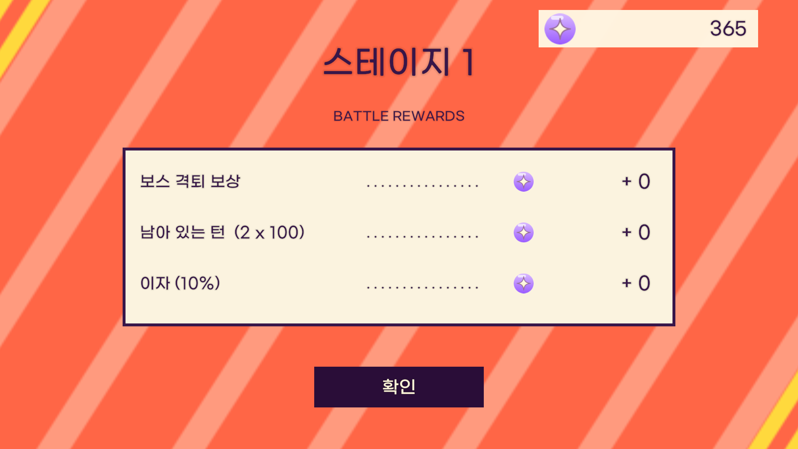
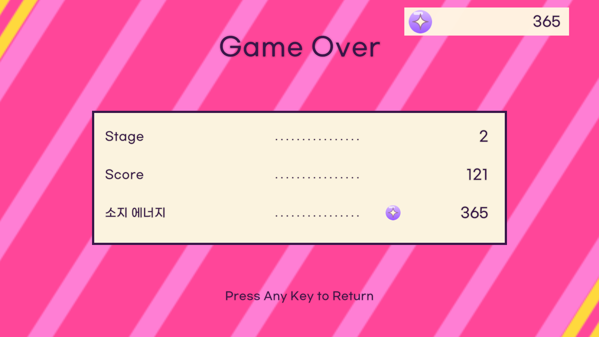

# 전투 보상·게임오버 화면

2026-11-06 요청과 로고 선택 답변을 정리한 구현 문서다. 이번 작업은 test 브랜치에서 진행하며 기존 정산·운세·시너지 규칙을 보존한다.

## 이 대화의 선행 합의

시너지 목록·학생증·영창 변경은 앞선 작업으로 main과 test에 반영했으며 [시너지 UI 구현 기록](Battle%20UI%20Editing.md#시너지-목록학생증-검사-ui-2026-11-06)에 정리되어 있다. 학교는 활성/비활성을 구분하고 흰색·최종 단계 노란색·비활성 회색을 사용한다. 학교·전투·학생증에서 단계 효과 팝업을 공유하고 학생증은 등장할 때마다 -10~10도 회전한다. 영창은 시너지 이름 대신 단어를 사용한다.

- 반항아: 단어 ‘꿈’, 설명 ‘반항아는 추가 액션을 갖습니다.’
- 독설가: 단어 ‘너네 XX’, 설명 ‘독설가는 디버프의 효과를 강화합니다.’
- 귀염둥이: 단어 ‘매력’, 설명 ‘귀염둥이는 귀엽습니다. 더 필요할까요?’
- ‘사진부 (3/1)’ 예시는 연극부를 의미한다. 정확한 인원 조건을 초과해 적용되지 않는 단계는 회색이다.
- Battle 목록 영역은 사용자 답변에 따라 test의 209×308을 유지한다.
- 이번 결과 화면 작업의 커밋·푸시 대상은 후속 요청에 따라 test다.

## 확정된 흐름

- 전투와 KO 연출이 끝나면 Battle 씬 위의 전체 화면 결과로 이동한다. 확인 전에는 다음 씬으로 넘어가지 않는다.
- 요청의 slides(1)은 저장소의 sides (1).png를 뜻하며 기존 하단부터의 순서대로 2번 분홍은 게임오버, 3번 주황은 보상에 사용한다.
- 선택한 타일이 왼쪽에서 들어와 화면을 덮은 위치에 멈춘다. 기존 battle_start 이미지가 0.5초 동안 페이드아웃한 뒤 정산 내용을 표시한다. 별도 게임 로고 대신 기존 이미지를 쓰라는 사용자 답변을 반영한다.
- 보상은 스테이지, 현재 에너지, 보스 격퇴·남은 턴·이자 세 줄로 구성한다. 각 제목과 점선을 한 글자씩 표시하고 숫자는 0.2초 후 표시한다. 1초 대기 뒤 각 보상 수치가 감소하면서 상단 에너지가 증가한다.
- Balatro의 항목별 정산 구성을 참고한다. [참고 자료](https://teemo.dev/game-design/balatro/wiki/mechanics/end-of-round/)의 게임 규칙을 복제하지 않고 프로젝트의 기존 보상 계산을 사용한다.
- 이자는 정산 전 에너지의 10%를 내림한다. 운세·획득 배율이 있으면 확정된 최종 보상 총액을 세 항목에 비례 배분하여 표시 합계를 보존한다. 선도부의 별도 전투 종료 보너스는 기존처럼 확인 시 추가 지급한다.
- 숫자 이동은 표시용 미리보기다. 실제 보상 지급·스테이지 증가·다음 날 초기화는 확인 시 기존 ReturnToSchool에서 한 번만 처리한다.
- 게임오버는 Game Over, Stage, Score, 소지 에너지를 점선과 우측 정렬 수치로 표시한다. Score는 새 게임부터 합동 공격 최종 데미지(초과 데미지 포함)와 커피 직접 데미지를 누적한다. 씬·스테이지 이동으로 초기화하지 않으며 새 게임에서 0이 된다.
- 진행 중 클릭은 모든 표시·숫자 이동 연출을 완료한다. 스킵한 클릭으로 동시에 씬을 넘기지 않는다.
- 게임오버 완료 후 Press Any Key to Return을 한 번에 표시하고 3초 주기로 부드럽게 점멸한다. 다음 클릭 또는 키 입력으로 메인으로 돌아간다.
- 확인/복귀 시 같은 로고가 다시 나타나고 덮인 상태에서 씬을 바꾼 뒤 타일이 오른쪽으로 빠져나간다.

## 편집과 코드

BattleResultCanvas의 ResultScreen 아래에 배경·로고·Content·세 줄·확인·복귀 문구를 씬 오브젝트로 저장한다. BattleRewardPopup Inspector에서 타자 간격, 숫자 대기, 전달 대기, 전달 시간, 로고 페이드, 스윕 시간을 조절한다. 에너지 아이콘은 사용자가 추가로 첨부한 보라색 별 이미지(MiracleEnergyIcon.png)를 원본 그대로 사용한다. 상단 잔액과 각 보상 줄에 같은 Sprite를 연결한다.

## 검증

최신 origin/main은 이미 포함되어 있었고, origin/test의 합동 공격 이미지·역할별 학생 이름표 변경을 보존해 병합했다. 코드·씬 충돌은 없었으며 AI 대화 CSV의 추가 기록 충돌은 양쪽 행을 보존했다. Unity 6000.3.7f1 통합 Windows 빌드와 다음 검사를 통과했다.

- 규칙 검사 5,337개: 기존 전투·학생·사진부·정산·확장 5,167개, 시너지 UI 109개, 결과 정산·누적 점수 61개.
- 초기 지급 2,000시드 검사.
- 실제 플레이어 결과 화면 103개: 전환·로고 0.5초·타자·숫자 대기·전달·클릭 스킵·실제 확인 버튼·중복 지급 방지·교실/메인 복귀·누적 점수·3초 점멸·720p/1080p 표시.
- 기존 플레이어 전투 연출 223개와 시너지 UI 281개 회귀 검사.
- 첨부 아이콘의 원본 파일과 임포트 에셋이 일치함을 확인했다. 보상 및 게임오버 캡처를 육안 확인했다.

재현: Editor의 HongikIngan.Editor.BattleResultBuilder.Build로 씬 적용·규칙 검사·Windows 빌드를 실행한다. 빌드 실행 파일에 --battle-result-smoke --smoke-output 출력폴더를 전달하면 결과와 캡처가 저장된다. 기존 --battle-arc-smoke 및 --synergy-ui-smoke도 사용할 수 있다. 수동 장시간 플레이와 오디오 청취 검사는 수행하지 않았다. 플레이어 종료 시 기존 ComputeBuffer 해제 경고가 남으며 기능 검사는 모두 통과했다.

주요 구현은 BattleRewardPopup.cs(결과 표시·입력·전환), BattleScreen.cs(확인), PrototypeRun.cs/CombatEngine.cs(누적 데미지), PrototypeSession.cs(메인 복귀), BattleResultBuilder.cs(씬 저작)다. 기존 보상 계산과 시너지 규칙은 유지했다.

### 최종 화면

보상 전달 완료 후 각 줄은 0, 상단은 합산 잔액을 표시한다.

## 사용자 요청 원문

전투가 종료되면 전투를 바로 종료하는 대신, 전투 보상 또는 게임오버 화면으로 전환되어 버튼을 누르면 다음 화면으로 돌아오도록 해. 현재 대화 내용은 문서화해서 완성되면 보여줘.

- 전투 보상 화면 또는 게임오버 화면이 시작되기 전에, slides(1)의 2번째 또는 3번째 스프라이트가 전환되다가 화면을 완전히 덮은 상태에서 멈추고, 게임 로고도 그 상태에서 0.5초간 fadeout돼.
- 전투 보상 화면
  - 해당(3스프라이트) 화면과 함께 미라클 에너지 아이콘과 현재 에너지 보유량이 표시돼. Balatro의 보상 화면을 레퍼런스로 해.
  - 화면 상단에는 스테이지 (스테이지 수)가 출력돼.
  - 다음이 한 줄씩, 좌측부터 한 글자씩 빠르게 출력돼. 숫자는 0.2초 정도 기다렸다가 출력돼. 숫자 출력을 완료한 지 1초가 지나면 숫자가 줄어들며 에너지 보유량으로 전달돼.
    - 보스 격퇴 보상 (에너지 아이콘 + 보상)
    - 남아 있는 턴 (에너지 아이콘 + ) (남아 있는 턴 \* 남아 있는 턴 보상)
    - 이자(10%) (에너지 아이콘 + 이자 획득량
  - 확인 버튼을 누르면 로고가 다시 뜨고, 교실로 돌아와.
  - 애니메이션 중간에 화면을 클릭하면 모든 애니메이션을 스킵해.
  - 숫자는 . . . . . .과 같은 가운뎃점으로 오른쪽 정렬시켜 줘.
- 게임 오버 화면
  - 2스프라이트 화면으로, 전투 보상 화면과 같은 연출
  - 제목 'Game Over'
  - Stage (게임 오버된 스테이지)
  - Score (지금까지의 누적 데미지)
  - 소지 에너지
  - 가운뎃점을 . . . . . . . 하나씩 출력하는 방법으로, 숫자를 오른쪽 정렬해 줘
  - 애니메이션 중 클릭하면 애니메이션이 스킵돼.
  - 하단에 Press Any Key to Return 텍스트를 표시해. (해당 텍스트는 한 번에 출력되며, 3초를 주기로 부드럽게 깜빡여)
  - 표시가 완료된 순간부터 클릭을 통해서 메인화면으로 돌아올 수 있어. 로고가 뜨고 화면으로 돌아오는 방식은 기존과 같아.
- test 브랜치로 이동하고, test 브랜치에 커밋 및 푸쉬해 줘.

### 추가 확인

질문: 현재 전환에 연결된 로고는 ‘방과후 전투 시작!’ 이미지이며 별도의 게임 로고 에셋은 없습니다. 보상·게임오버 전환에는 어떤 로고를 사용할까요?

답변: 기존 ‘방과후 전투 시작!’ 이미지 사용

### 에너지 아이콘 교체

추가 요청: 에너지 아이콘으로는 이걸 대신 사용해 줘

사용자가 첨부한 보라색 별 아이콘을 상단 잔액과 각 결과 줄에 공통으로 적용한다.
