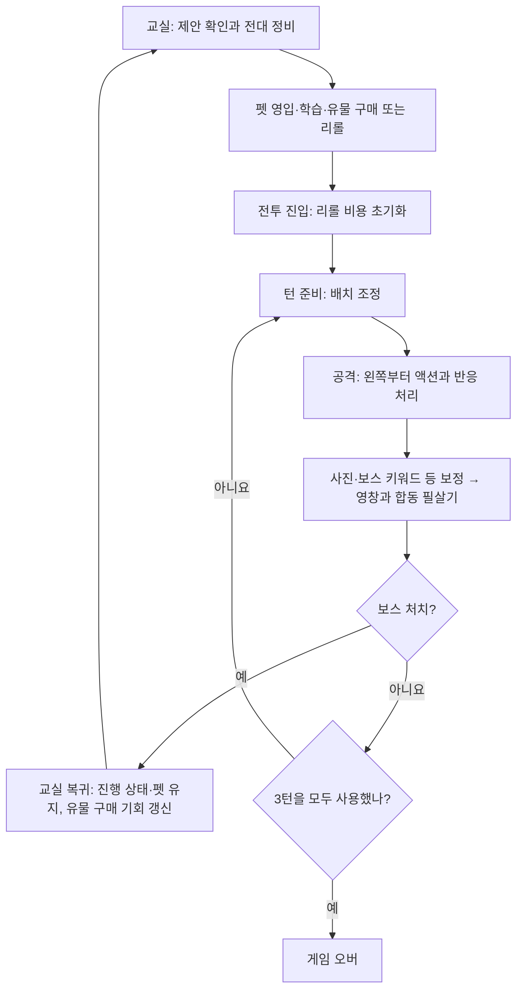

# 게임 전체 흐름과 덱 예시 — 작업자용 요약

갱신일: 2026-11-05

## 1. 어떤 게임인가

교실에서 마법소녀를 영입하고 강화한 뒤, 전투에서 배치 순서와 스킬의 연결로 합동 필살기의 데미지를 만드는 게임이다. 보스마다 최대 3턴의 기회가 있으며, 처치하면 교실로 돌아가 전대를 보강하고 다음 전투를 준비한다.

이 문서에서 **덱**은 보유 마법소녀의 구성·배치 순서·유물·폴라로이드를 합친 운영 조합을 뜻한다. 손패에서 카드를 뽑아 내는 방식이라는 의미는 아니다. 작업자는 우선 “어떤 학생을 모으고, 어떤 순서로 행동시키며, 그 조합에 재화를 어떻게 투자하는가”를 이해하면 된다.

캐릭터의 체력·방어력·치명타·속도는 없다. 전투에서 만들어 내는 중심 결과는 **전대 전체의 합동 데미지**이며, 보스 체력은 그 공격으로 깎아야 할 목표다. Buff·Debuff·Dealer는 스킬을 이해하기 위한 표시이고, 역할군을 모았다는 이유만으로 별도 보너스가 생기지는 않는다.

## 2. 전체 플레이 흐름

### 교실: 이번 전투에 쓸 덱 만들기

학생은 책상에 일렬로 배치된다. 새 학생은 펫으로 영입하고, 보유 학생을 눌러 스킬·시너지를 확인하거나 보충 학습·계약 해제를 선택한다. 같은 학생은 중복 보유할 수 없다. 기본 자리는 3칸이며 일반 최대 7칸, 슬롯 증가 유물 포함 최대 9칸이다. 새 게임의 시작 학생 1명은 유지한다.

| 선택 | 얻는 것 | 함께 포기하거나 고려할 것 |
| --- | --- | --- |
| 보충 학습 | 보유 학생의 스킬 변수 하나를 강화 | 그 재화로 새 학생이나 유물을 살 기회. 스킬마다 1회형·무한형이 다름 |
| 유물 구매 | 한 번에 표시되는 유물 1개를 구매 | 전투당 1회만 가능하며 구매 후 리롤도 잠김. 보유 유물은 중복 구매 불가 |
| 펫 구매 | 선결제 후 새 후보군에서 최대 1명 영입, 남은 후보는 사진 획득 | 후보를 보기 전 비용 지불. 영입 포기에도 환불 없음 |
| 유물 리롤 | 구매 전 유물 제안 1개만 갱신 | 펫은 그대로 유지. 비용은 20→40→60으로 증가 |
| 계약 해제·교체 | 학생을 판매해 재화와 자리를 확보 | 재영입해도 이전 강화 상태는 돌아오지 않음 |

펫 가격에는 영입비가 포함된다. 일반 펫은 후보 3명, 고급·최고급은 5명, 시너지 펫은 3명이며 **어느 펫이든 최대 1명만 영입**한다. 선택하지 않은 학생의 사진은 중복 누적된다. 펫 결제가 성공하면 사용한 자리에만 즉시 새 펫이 채워지며, 현재 후보 선택을 마친 뒤 다음 펫을 이용할 수 있다. 일반 모집 상점은 없다.

시너지 펫은 보유 학생이 많이 속한 시너지가 뽑히기 쉬워 현재 덱의 방향을 이어 갈 때 사용할 수 있다. 특수 시너지는 제외하며 특정 학생을 보장하지 않는다. 펫 선택 중에는 다른 정비 행동과 전투 진입을 제한하고, 자리 확보를 위한 교체 패널 판매는 허용한다.

### 전투: 구성한 덱을 실행하기

1. 학생의 배치를 조정하고 공격 버튼을 누른다. 합동 데미지는 매 턴 0에서 시작한다.
2. 왼쪽부터 학생의 액션을 처리한다. 키워드 부여, 데미지 증가, 보스 약화, 위치 교환 등이 연결되고 조건에 맞는 반응도 발생한다.
3. 데미지는 효과가 발생한 순서대로 바뀌며 표시에도 반영된다. 같은 학생이어도 앞뒤 순서에 따라 결과가 달라질 수 있다.
4. 개별 액션이 끝나면 폴라로이드와 보스 키워드 등의 보정을 반영한다. 유물은 각자의 발동 시점에 적용된다.
5. 구성한 시너지를 반영한 영창과 빔 공격 후 보스에게 최종 데미지를 전달한다.

보스가 살아 있으면 남은 턴 안에서 재배치해 다시 공격한다. 이때 합동 데미지 표시가 0으로 시작한다고 해서 이미 깎은 보스 체력이 복구되는 것은 아니다. 세 번째 공격까지 처치하지 못하면 게임 오버다. 세 번째 공격으로 처치하면 승리한다.

### 교실 복귀: 결과를 보고 덱 보강하기

승리하면 학생·강화·재화·유물·사진·남아 있는 펫을 유지한 채 교실로 돌아온다. 유물 구매 기회가 1회로 갱신되고 미보유 유물 1개가 제시된다. 리롤 비용은 전투 진입 때 초기화되어 있다. 이번 전투에서 부족했던 것이 기본 데미지인지, 배율인지, 키워드 연결인지 판단하고 다음 투자를 고른다.

## 3. 덱 예시로 보는 선택

아래 4개는 현재 프로토타입의 **임시 학생과 스킬**을 이용한 설명이다. 정식 캐릭터 설정이나 추천 최적 덱을 확정하지 않는다. 수치 예시는 강화 전 스킬만 분리한 계산이며, 별도 언급이 없으면 유물·부활동 시너지·사진 보정을 제외한다. 실제 화면에서는 float 계산과 소수점 버림 표시에 따라 차이가 날 수 있다.

### 덱 A. 기본 데미지를 쌓고 마지막에 곱하는 덱

**배치: 아리 → 소라 → 예린**

| 학생 | 이 예시에서 하는 일 |
| --- | --- |
| 아리 | 합동 데미지 +100 |
| 소라 | 합동 데미지 +100 |
| 예린 | 그때까지 쌓인 합동 데미지 ×1.4 |

스킬만 계산하면 `(100 + 100) × 1.4 = 280`이다. 예린을 가운데 두면 `100 × 1.4 + 100 = 240`이 된다. 구성원이 같아도 순서가 공격의 결과를 바꾼다는 가장 기본적인 예시다.

**여기서 생기는 선택**

- 더하기 담당을 강화해 곱하기 전의 원금을 늘릴지, 예린을 강화해 배율을 높일지 고른다.
- 새 학생이 나오면 단독 수치만 보지 않고, 현재 더하기·곱하기 연결에서 누구를 대체할지 비교한다.
- 사진은 개별 학생 액션이 끝난 뒤 더해지므로, 예린의 스킬 배율이 뒤늦게 더해지는 사진 데미지까지 곱한다고 생각하면 안 된다. 유물도 적용 시점을 확인해야 한다.

### 덱 B. 키워드를 다음 학생에게 전달하는 덱

**배치: 하린 → 아리 → 예린**

| 학생 | 이 예시에서 하는 일 |
| --- | --- |
| 하린 | 다음 아군에게 별빛 키워드 부여 |
| 아리 | 자신의 행동에서 별빛 효과를 적용하고 기본 데미지를 더함 |
| 예린 | 앞에서 만든 합동 데미지에 배율 적용 |

프로토타입의 별빛은 소모성·중첩 가능·휘발성 키워드다. 강화 전 하린의 별빛은 적용 시 +100을 주므로, 이 순서의 스킬 계산은 `(별빛 100 + 아리 100) × 1.4 = 280`이다. 덱 A와 결과 숫자가 같아도, 중간에 키워드를 전달하고 소비하는 과정이 있어 다른 키워드 반응 효과와 연결할 여지가 생긴다.

**여기서 생기는 선택**

- 하린을 강화해 전달하는 효과를 키울지, 아리를 강화해 직접 데미지를 키울지 고른다.
- 누구를 “다음 아군”으로 만들지 배치로 정한다. 버프 학생이라는 표지만 보고 배치하지 않고 실제 대상 규칙을 읽어야 한다.
- 별빛은 쌓일 수 있지만 적용마다 1스택을 쓰며, 턴이 끝나면 남은 스택도 사라진다. 이번 턴 안에 활용할 연결인지 확인한다.

일반 키워드에는 비휘발성도 존재하므로 모든 키워드가 턴 끝에 사라지는 것은 아니다. 개별 키워드의 소모·중첩·휘발 속성을 확인한다.

### 덱 C. 다른 아군의 행동을 추가 공격으로 바꾸는 덱

**배치: 아리 → 소라 → 미리**

| 학생 | 이 예시에서 하는 일 |
| --- | --- |
| 아리·소라 | 자신의 슬롯에서 합동 데미지를 더함 |
| 미리 | 자신의 액션뿐 아니라 다른 아군의 액션에도 반응해 데미지를 더함 |

프로토타입의 미리는 다른 아군 액션에 반응하는 학생이다. 아리 행동 뒤 미리 반응, 소라 행동 뒤 미리 반응, 이후 미리 자신의 슬롯 행동으로 이어진다. 핵심은 강한 학생 한 번의 행동을 사는 것과, 아군의 여러 행동에 반복해서 기여할 학생을 사는 것의 차이다.

**여기서 생기는 선택**

- 반복해서 기여하는 미리에게 강화 비용을 집중할지, 다른 학생의 개별 기여를 높일지 고른다.
- 슬롯이 늘어났을 때 새 학생의 직접 효과와 그 행동으로 생기는 반응까지 함께 평가한다.
- 기본 데미지 담당을 이동·키워드·지원 학생으로 바꾸더라도 반응에 기여할 수 있는지 살핀다. 정확한 반응 조건은 스킬마다 확인한다.

확정 규칙상 반응 액션도 다른 아군의 반응을 발생시킨다. 위치 교환 시에는 바뀐 자리 기준 작은 번호의 소녀부터 큰 번호의 소녀까지 다시 행동한다. 이런 효과는 행동 횟수를 늘리는 조합으로 연결될 수 있다. 다만 현재 예시 덱은 이동 스킬을 사용하지 않으며, 무한 콤보를 완성된 운영 방식으로 가정하지 않는다. 무한 콤보는 발견 후 조치하기로 한 상태다.

### 덱 D. 당장의 공격과 이후 성장을 나누는 재화·사진 덱

**배치 예시: 다온 → 아리 → 나래 / 보유 자산: 펫에서 얻은 폴라로이드**

| 구성 요소 | 이 예시에서 하는 일 |
| --- | --- |
| 다온 | 액션으로 재화 획득 |
| 아리 | 기본 합동 데미지 생성 |
| 나래 | 보스가 받는 피해를 늘리는 키워드 부여 |
| 폴라로이드 | 개별 액션 종료 후 사진 장수에 따라 데미지 추가 |

다온은 직접 공격 대신 다음 교실에서 쓸 재화를 마련하고, 사진은 학생의 개별 공격 밖에서 데미지를 보충한다. 나래의 보스 약화는 최종 보정에 연결된다. 같은 자리의 다온을 직접 데미지 학생으로 바꾸면 당장의 공격을 늘릴 수 있지만 재화 획득을 포기하게 된다.

**여기서 생기는 선택**

- 3턴 안에 처치할 공격력이 확보되었는지 보고 재화 담당을 남길지 정한다. 재화를 더 벌려고 턴을 사용하는 동안 실패할 위험도 있다.
- 교실에서는 보유 학생 강화에 돈을 쓸지, 새 후보와 사진을 함께 얻는 펫에 쓸지 비교한다.
- 펫 후보가 현재 덱보다 낫지 않으면 기존 학생을 유지하고 사진만 받을 수도 있다. 포기는 환불이 없으므로 무료 성장으로 취급하지 않는다.
- 사진은 덱의 구성원을 바꾸지 않고도 쌓이지만, 사진만으로 전투를 해결할 수 있다고 보장하지 않는다.

이 예시는 재화·사진이라는 자원의 연결을 보여 준다. 콘텐츠 문서의 선도부·사진부 고유 효과를 모두 구현한 덱이라는 뜻은 아니다.

## 4. 한 번의 정비에서 실제로 무엇을 고민하는가

현재 덱이 **아리 → 소라 → 예린**이고 자리가 모두 찼다고 하자. 교실의 유물과 펫을 보고 다음 선택을 비교한다. 하린은 펫에서 공개될 수 있는 후보의 예시다.

1. **현재 덱 유지·강화:** 이미 작동하는 더하기→곱하기 구성을 강화한다. 새 조합을 찾는 비용을 아끼지만 구성은 그대로다.
2. **펫에서 하린이 나오면 소라와 교체:** 직접 더하기를 키워드 전달로 바꾼다. 이후 키워드 반응 학생을 만났을 때의 연결 가능성을 고려하되, 소라의 기존 강화는 판매 후 되돌릴 수 없다.
3. **유물 구매 또는 리롤:** 현재 제안 1개를 구매하거나 비용을 내고 바꾼다. 유물은 전투당 한 번만 구매할 수 있으므로 효과와 발동 시점을 확인하고 결정한다. 구매한 뒤에는 리롤할 수 없다.
4. **펫으로 새 후보 찾기:** 후보 공개 전 결제하고 최대 1명만 고른다. 사용한 펫은 즉시 보충되며, 다른 펫은 유지된다.
5. **현재 구성으로 전투 진입:** 추가 지출 없이 전투로 간다. 이번 보스를 넘길 수 있을지 판단하고, 승리 후 새 교실 제안을 기대한다.

이 게임의 선택은 “가장 높은 학년을 산다” 하나로 요약되지 않는다. **이번 전투를 넘길 힘, 현재 덱과의 연결, 앞으로 쓸 재화, 자리를 바꿀 때 잃는 투자**를 함께 비교하는 구조다.

## 5. 부활동 중심으로 덱을 설명할 때

앞의 예시는 스킬 조합이고, 부활동은 덱의 운영 방향을 설명하는 또 하나의 축이다. 다음은 기존 콘텐츠 방향이며 고유 효과의 세부 수치·발동 조건은 별도 기획을 따른다.

| 부활동 방향 | 작업자가 떠올릴 수 있는 덱 구성 | 중심 선택 |
| --- | --- | --- |
| 운동부: 단순한 힘 | 직접 데미지와 배율을 조합하는 덱 | 직접 수치 강화와 배율 강화 중 어디에 투자할까? |
| 천문부: 반복 발동·축적 | 축적에 기여하는 학생을 모으는 덱 | 현재 공격과 축적의 이득을 어떻게 배분할까? |
| 선도부: 재화 획득 | 전투 기여와 재화 획득을 함께 챙기는 덱 | 3턴 처치 가능성을 유지하면서 성장 자원을 얼마나 확보할까? |
| 미술부: 그림에 따른 무작위 효과 | 다양한 결과를 활용할 구성의 덱 | 확실한 효과와 변동성 있는 효과를 얼마나 섞을까? |
| 연극부: 단독·특정 인원 조건 | 효과 조건에 맞춰 인원을 구성하는 덱 | 다른 학생을 더 넣는 이익과 조건 유지 중 무엇이 클까? |
| 사진부: 폴라로이드 활용 | 학생 전투력과 사진 누적을 함께 키우는 덱 | 영입·강화와 사진을 얻는 구매 사이에 재화를 어떻게 나눌까? |

## 6. 작업자가 기억할 경계와 상세 문서

- **학생·역할군·시너지는 구별한다.** 역할군은 표시용이고, 부활동 등 시너지는 별도의 효과 규칙을 가진다. 책상 위 책 개수는 보유 시너지 수다.
- **교실에서 구성하고 전투에서 배치·실행한다.** 전투 도중 교실 구매를 하는 흐름은 아니다. 펫 선택을 끝내지 않았거나 학생이 한 명도 없으면 전투에 들어갈 수 없다.
- **합동 데미지·키워드·사진은 수명이 다르다.** 합동 데미지는 매 턴 초기화하고, 키워드는 개별 속성을 따르며, 사진은 현재 진행의 보유 자산으로 누적된다.
- **이 문서의 덱은 설명 예시다.** 임시 캐릭터와 수치를 정식 콘텐츠로 확정하지 않으며, 부활동별 고유 효과가 모두 구현된 상태도 아니다.

상세 규칙은 [전투 기획서](Game%20System%20Design.md), [교실 기획서](Classroom%20System%20Design.md), [마법소녀 속성](Magical%20Girl%20Attributes.md), [교실 결정사항](Decisions/Classroom/README.md)을 확인한다. 콘텐츠 방향은 [시너지와 아트 스타일](시너지와아트스타일.md), 현재 실행 범위는 [프로토타입 안내](Prototype%20Guide.md)를 따른다. 예시 학생은 [프로토타입 콘텐츠](../../UnityProject/Assets/Scripts/School/PrototypeContent.cs)의 임시 정의를 기준으로 했다.
