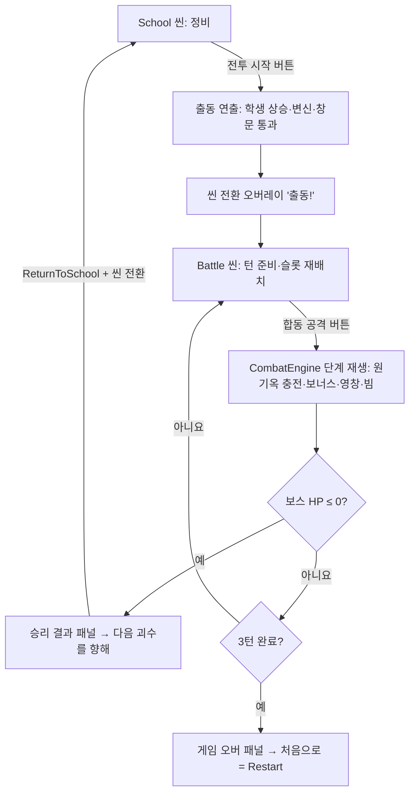

# 교실·전투 UI 목업 → Unity 구현 기획서 v2

- 작성일: 2026-11-06 (Asia/Seoul)
- 기준 목업: Claude 아티팩트 「교실 로비 — 인터랙티브 목업」 버전 `1793891994-6c92`
  (링크: https://claude.ai/artifact/TRmy3QV2iULcLgoU3GRAPr · 비공개, 공유 필요 시 소유자가 공유)
- 기준 프로젝트: 저장소 `test` 브랜치 작업 트리, Unity 6000.3.7f1
- 참고 Figma: 교실 배치 `yHYw4NLBwpvX7VFbZA7dzr`(Slide 16:9 - 1·2), 전투 배치 `WK95sJUQ8A2iHXjwDT6dXJ`(Slide 16:9 - 1)
- 상태: 초안. 구현·검증 완료를 뜻하지 않는다.
- v1 대비: 사용자 결정 반영 — 유물 UI는 **사물함**, 학생 상세는 **학생증 카드**로 확정. 승리 이자는 미정 유지. 공용 코드 변경 항목을 구체화하고 편집기 검사 제약을 추가했다([10장](#10-결정-사항), [11장](#11-공용-코드-변경-제안)).

## 0. 이 문서의 원칙

1. 목업은 **화면 배치와 연출을 미리 보기 위한 참고**다. 게임 규칙, 수치, 데이터 구조는 **프로젝트 문서와 코드가 우선**한다.
2. 목업과 프로젝트가 다른 부분은 모두 프로젝트 기준으로 고쳐 적었다. 목업에만 있는 값은 [9장](#9-목업-전용-값--unity에-반영하지-않는다)에 따로 모았다.
3. 프로젝트 문서끼리, 또는 목업 배치와 문서 규칙이 충돌해 한쪽으로 정할 수 없는 항목은 **결정 필요**로 표시했다. 기본값은 프로젝트 문서 쪽이다.
4. 공용 계약(`PrototypeRun`, `CombatEngine`, `EconomySettings`, `PrototypeSession`)을 바꿔야 하는 항목은 AGENTS.md 4장에 따라 담당자 합의 후 진행한다.

## 1. 근거 문서와 코드

| 구분 | 경로 |
| --- | --- |
| 교실 규칙 | [교실 시스템 기획서](../Classroom%20System%20Design.md), [교실 결정 CL01~CL07](../Decisions/Classroom/README.md) |
| 전투 규칙 | [게임 시스템 기획서](../Game%20System%20Design.md), [게임 시스템 플로우차트](../Game%20System%20Flowchart.md) |
| 학생 데이터 | [마법소녀 속성](../Magical%20Girl%20Attributes.md), [마법소녀 서식](../Girls/README.md), [시너지 목록](../Girls/synergy.md), [키워드 목록](../Girls/keywords.md) |
| 콘텐츠 방향 | [시너지와 아트 스타일](../시너지와아트스타일.md) |
| 현재 구현 | [프로토타입 안내](../Prototype%20Guide.md), [전투 UI 편집](../Battle%20UI%20Editing.md), [test 브랜치](../Test%20Branch.md) |
| 코드 | `Assets/Scripts/School/{PrototypeRun, PrototypeContent, EconomySettings}.cs`, `Assets/Scripts/Combat/CombatEngine.cs`, `Assets/Scripts/UI/{SchoolScreen, SchoolStudentSlot, BattleScreen, BattleHud, BattleFormationView, BattleStudentSlot, BattlePresentation}.cs`, `Assets/Scripts/Prototype/PrototypeSession.cs`, `Assets/Scripts/Prototype/Editor/{SchoolLayoutBuilder, BattleLayoutBuilder}.cs`, `Assets/Resources/PrototypeEconomy.asset` |

## 2. 전체 흐름: 목업과 프로젝트의 차이

**가장 큰 차이는 턴 구조다.** 목업에서는 턴마다 교실로 돌아와 다시 출동한다. 프로젝트에서는 **한 번 전투 씬에 들어가면 그 안에서 최대 3턴**을 진행하고, 턴 사이에는 전투 씬에서 슬롯을 드래그해 재배치한다. 교실은 보스를 잡은 뒤에만 돌아온다(test 브랜치는 예외로 3턴부터 복귀 버튼이 있다).

| 항목 | 목업 | 프로젝트(적용 기준) |
| --- | --- | --- |
| 씬 | 한 페이지 안에서 교실/전투 전환 | `School.unity` / `Battle.unity` 분리. `PrototypeSession`(DontDestroyOnLoad)이 진행 상태 보존 |
| 턴 | 출동 1회 = 1턴. 실패하면 교실로 귀환 | 전투 씬 안에서 1~3턴. 턴 사이 재배치는 전투 씬 슬롯 드래그 |
| 남은 턴 표시 | 교실 출동 버튼 옆 배지 | 전투 HUD `Turn` 라벨(`TURN n/3`). 교실에는 남은 턴 개념이 없다 |
| 공격 시작 | 출동하면 자동 진행 | 매 턴 `ActionButton`(합동 공격) 입력으로 시작 |
| 결과 | 승리 패널·게임 오버 패널 | `ActionButton`이 승리 복귀/재시작을 겸함. 패널은 UI로 추가 가능([8장](#8-결과-화면)) |

## 3. 핵심 차이 요약

| 영역 | 목업 | 프로젝트 기준 | Unity 적용 |
| --- | --- | --- | --- |
| 재화 이름·시작값 | 코인, 200 | **미라클 에너지**, `startingMoney` 160 | HUD 라벨·값을 `Run.Money`로 |
| 학생 데이터 | 학년·부·성격을 랜덤 생성, 중복 허용 | `StudentDefinition` 카탈로그(이름·학년·역할군·부활동·성격·특수 시너지·스킬). **중복 보유 불가**, 후보에서 보유 학생 제외 | 목업의 랜덤 생성 로직은 버린다 |
| 시작 전대 | 1학년 6명 | 시작 학생 1명(카탈로그 0번 아리), 기본 정원 3 | `PrototypeRun` 생성자 유지 |
| 책상 수 | 항상 6 | 정원 3 → 책상 확장(40)으로 최대 7, 슬롯 유물 포함 최대 9 | 책상 9개 위치를 정의([5.6](#56-학생책상드래그)) |
| 유물 | 사물함 3칸, 120~500 랜덤 가격, 사물함 위 진열 | 제안 3개, 가격 `relicPrice` 30, 중복 획득 불가, 누적 표시(CL04는 '칠판'으로 기재) | **사물함으로 확정**. 규칙·가격은 프로젝트 기준([5.2](#52-유물-상점)) |
| 리롤 | 50 고정, 유물만 갱신 | 20부터 +20씩 증가. **모집·유물·펫 제안을 함께 갱신**. 전투 진입 시 20으로 초기화 | `Run.Reroll()` |
| 일반 모집 | 없음 | 후보 3명, 학년 가중치 4:2:0.5, 학년별 영입가 30/60/90 | **목업에 없던 UI 추가 필요**([5.4](#54-전학생-모집--목업에-없음)) |
| 펫(팩) | 비둘기 클릭 → 4종 중 3종 랜덤 팝업. 100/150/300/180. 한 턴에 1회 | 제안 3칸을 칸마다 독립 추첨(40/30/10/20%, 일반 3개면 재추첨). 일반·고급·최고급·시너지 30/50/100/60. 후보 3/5/5/3. **칸마다 1회 사용**, 리롤·승리 시 갱신. 선결제·최대 1명·포기 가능(환불 없음) | 비둘기는 `PetOffers`를 여는 진입점으로 사용([5.5](#55-펫-부르기비둘기)) |
| 폴라로이드 | 데려온 펫 전원(선택된 학생 포함)이 사진을 붙임 | **선택하지 않은 후보만** 사진 획득(포기 시 전원). 같은 학생 중복 누적 | 선택된 학생의 펫은 사진을 붙이지 않는다 |
| 학생 클릭 | 왼쪽 학생증 카드 + 보내주기/보충학습 | 상세 화면(현재 `StudentDetailBook`, 교실 기획서는 '책 형태'로 기재): 이름·설명·스킬 + 계약 해제·보충 학습 | **학생증 카드로 확정**. 내용은 프로젝트 데이터([5.7](#57-학생-상세계약-해제보충-학습)) |
| 판매 | 보내주기 100/150/200 | 계약 해제 15/30/45. 재영입 시 강화 초기화 | `Run.Sell(index)` |
| 보충 학습 | 300, 확인 팝업만, 효과 없음 | 20/40/60. 1회형/무한형. `SkillValue` 실제 교체 | 확인 팝업은 UI로 추가 가능, 확정 시 `Run.Upgrade(index)` |
| 교체 | 빈 책상이 없으면 보낼 학생 선택 → 새 학생 자동 착석 | 교체 패널(얼굴·이름만)에서 판매. **판매와 새 학생 선택은 별개**, 자동 영입하지 않음 | 판매 후 다시 후보를 눌러 영입 |
| 시너지 표시 | 책장 위에 활성 카테고리(2명 이상) 책 쌓기 | 책상 위 책 = **학생 1명의 보유 시너지 수**(2~3권). 오른쪽 `SynergyPanel`에 시너지별 인원 | 책상 책 유지 + 책장 연출은 `SynergyPanel` 시각화로([5.10](#510-시너지-표시)) |
| 데미지 계산 | 학년별 100/200/300 합 → 시너지 ×(1+Σ0.n) → 폴라로이드 +10/장 | `CombatEngine` 순서: 유물(턴 시작) → 부활동 시너지(임시 +20/인원) → 슬롯별 액션·키워드·반응 → 폴라로이드(`polaroidDamage` 10/장) → 유물 최종 배수 → 보스 키워드 → 영창 → 빔 | 연출은 `BattleStep`을 따라 재생([7.3](#73-데미지-단계와-연출-매핑)) |
| 보스 HP | 1500, 다음 괴수마다 +500 | `bossBaseHp` 450 × `bossGrowth` 1.65^(Stage−1). test 브랜치는 무한 | HUD는 `Battle.BossHp/MaxBossHp` |
| 처치 보상 | 500 + 보유 100당 10 | `victoryReward` 70 + 15×(Stage−1) + 유물 `VictoryMoney` | 이자는 결정 필요 |
| 처음부터 | 즉시 초기화 | `새 게임` 버튼 → 확인 → `PrototypeSession.Restart()` | 확인 단계 유지 |

## 4. 좌표 변환 규칙

목업은 1920×1080 기준이다. 프로젝트 Canvas 기준 해상도에 맞춰 아래처럼 환산한다. 좌표는 `SchoolLayoutBuilder`/`BattleLayoutBuilder`와 같이 **왼쪽 위 원점, 아래 방향 +y**로 적는다(RectTransform anchor·pivot (0,1), `anchoredPosition = (x, -y)`).

| 씬 | Canvas 기준 | 환산 |
| --- | --- | --- |
| School | `SchoolCanvas` 1440×810, match .5 | x·y·크기 모두 ×0.75 |
| Battle | `BattleCanvas/Layout` 1440×900, Expand | x·가로 ×0.75, y·세로 ×0.8333 (비율 차이로 세로 여백 생김) |

아래 표의 좌표는 이 규칙으로 환산한 값이다. 최종 위치는 Hierarchy에서 조정하고 씬을 저장한다.

## 5. 교실(School 씬)

### 5.0 선행 작업: 런타임 재배치 제거

`SchoolScreen.Refresh()`는 매 갱신마다 `DeskSlot`의 `anchoredPosition`과 `localScale`을 일렬로 다시 계산한다. 목업처럼 원근이 있는 2열 배치를 쓰려면, 이 재배치를 없애고 씬에 저장된 위치를 유지해야 한다. `BattleHud`가 "authored RectTransforms are never repositioned" 원칙을 따르는 것과 같은 방식이다. 표시 여부(`SetActive`)만 정원에 따라 바꾼다.

또한 펫 선택·교체·새 게임 확인·사운드 창은 현재 `OnGUI`(IMGUI)로 그린다. 목업의 팝업은 uGUI 패널(`Assets/UI/` 프리팹 또는 SchoolCanvas 하위 오브젝트)로 옮기는 것을 전제로 한다.

### 5.1 화면 배치표

| 목업 요소 | SchoolCanvas 오브젝트 | 환산 좌표 (x, y, w, h) | 데이터·규칙 |
| --- | --- | --- | --- |
| 뒷벽·옆벽·바닥 원근 | `ClassroomBackdrop`, `WallWainscot`, `Floor` 교체/추가 | 뒷벽 (166, 0, 1155, 563), 바닥선 y≈560 | 장식. `Assets/UI/` 스프라이트 |
| 재화 HUD | `Energy` | (21, 18, 228, 64) | `미라클 에너지 {Run.Money}` |
| 전대 인원 | `Roster` | HUD 오른쪽 유지 | `{Students.Count} / {Capacity}` |
| 스테이지 | `Stage` | 유지 | `STAGE {Stage:00} · 방과 전` |
| 처음부터 | `NewGame` | (1307, 21) 부근 | 확인 후 `Restart()` |
| 사운드 | `Sound` | `NewGame` 옆 | `BattleAudioPanel`과 같은 3채널 |
| 시계·달력 | 신규 `WallClock`, `Calendar` | 시계 중심 (284, 124) r51, 달력 (806, 45, 66, 75) | 순수 장식 |
| 폴라로이드 게시판 | 신규 `PolaroidBoard` (+ 기존 `Photos` 라벨 이동) | 판 (435, 15, 357, 242), 카운터 (801, 125, w84) | `Run.Photos`, `Run.PhotoCount` |
| 사물함(유물 3칸) | `Chalkboard` → 사물함 그래픽으로 교체, 자식 `RelicOffer0~2` 유지 | 사물함 (166, 289, 627, 269), 유물 칸 = 맨 윗줄 왼쪽 3칸 | `RelicOffers`, `relicPrice` |
| 사물함 위 획득 유물 | `Chalkboard/OwnedRelics` | (170, 222, 618, 53) | `Run.Relics` |
| 리롤 버튼(사물함 4번째 칸) | `Reroll` | (434, 298, 83, 80) | `새로운 만남 · 리롤 {RerollCost}` |
| 책장 | 신규 `Bookshelf` | (886, 299, 336, 290) | 장식 |
| 책장 위 시너지 책 | `SynergyPanel` 재구성 | (890, 113, 330, 184) | 5.10 참조 |
| 책상 6개(뒤 3·앞 3) | `StudentDesks/DeskSlot0~5` | 크기 208. 뒤 (631,434) (860,436) (1089,436) / 앞 (545,536) (784,536) (1014,538) | `StudentAtSchoolDesk(i)` |
| 책상 7~9 | `DeskSlot6~8` | 결정 필요 | 정원 확장 시 표시 |
| 비둘기 우체부 | 신규 `PetCaller` | (89, 579, 143, 188) | 펫 제안 진입점(5.5) |
| 문(미닫이) | 신규 `ClassDoor` | 사변형 (23,177) (86,147) (86,680) (22,781) | 펫 출입 연출 |
| 펫 대기 줄 | 신규 `PetQueue` | x 248 + 60i, y 709, 펫 57×64 | 후보 수만큼 |
| 창문 | 신규 `Window` (`Glass`, `Broken`) | 사변형 (1373,125) (1440,173) (1440,482) (1373,434) | 출동 연출(6장) |
| 출동 버튼 | `EnterBattle` | (1193, 671, 221, 110) | `방과 후! 전투 시작` |
| 전학생 모집 | `Recruitment` | 목업에 없음. 제안 5.4 | `RecruitOffers` |
| 상태 메시지 | `Status` | 하단 유지 | `Run.LastMessage` |
| 학생증 카드 | `StudentDetailBook` → 학생증 그래픽으로 교체(5.7) | 카드 (27, 96, 323, 가변) — 목업 (36,128,430w) 환산 | 선택 학생 또는 모집 후보 |
| 책상 확장 | `ExpandDesks` | 출동 버튼 위 등 | `slotExpansionPrice` 40 |

### 5.2 유물 상점

- **규칙(프로젝트):** 제안 3개, 개당 30(`relicPrice`), 보유 유물은 다시 획득할 수 없고 후보에서도 제외. 구매한 칸은 리롤이나 승리 후 복귀까지 빈 칸. 유물은 효과가 있는 실제 데이터(`PrototypeCatalog.Relics`: 빛나는 분필, 별의 리본, 접이식 책상 등 6종)다. 목업의 더미 유물과 120~500 랜덤 가격은 쓰지 않는다.
- **표시:** 칸마다 유물 아이콘(빈 도형), 이름, 가격, 설명(툴팁 또는 상세)을 보여 준다. 구매 시 아이콘이 획득 진열대로 날아가는 연출은 그대로 쓸 수 있다.
- **확정 — 사물함 배치:** 유물 제안은 사물함 맨 윗줄 왼쪽 3칸(문이 열린 칸)에, 획득한 유물은 사물함 위 진열대에 놓는다. 네 번째 칸에 리롤 버튼을 붙인다. 나머지 칸은 닫힌 장식 문이다.
  - 오브젝트: 기존 `Chalkboard`의 그래픽(칠판색 `Fill`, `Caption`)을 사물함으로 바꾸고 `RelicOffer0~2`, `OwnedRelics` 자식과 `SchoolScreen.relicButtons/relicLabels/ownedRelicsLabel` 참조는 그대로 유지한다. 이름을 바꾸려면 Unity Editor에서 바꾼다(코드는 이름으로 찾지 않는다).
  - `OwnedRelics`는 지금 텍스트 한 줄(이름 나열)이다. 사물함 위에 아이콘을 늘어놓는 표시는 새 뷰(가칭 `RelicShelfView`)가 `Run.Relics`를 읽어 그린다. 진열 칸 수는 유물 풀 크기(현재 6종)에 맞춘다.
  - 문서 정합성: CL04와 교실 기획서의 '칠판에 누적 획득 유물을 표시' 문구를 '사물함 위에 표시'로 고쳐야 한다(팀 문서 갱신 필요).
- **사물함 문 연출:** 목업의 '리롤 시 문이 닫혔다 열림'은 리롤 성공(`Reroll()`이 true)일 때만 재생한다. 잔액 부족으로 실패하면 문을 움직이지 않는다(CL02: 실패 시 제안과 비용 단계 유지).

### 5.3 리롤

- 비용: `RerollCost`. 처음 20이고 성공할 때마다 `rerollIncrease`(20)만큼 오른다(20 → 40 → 60). 전투 진입 시 20으로 돌아간다.
- 범위: 유물·전학생 모집·펫 제안 세 패널을 동시에 갱신한다. 보유 학생·유물·사진은 유지된다.
- 연출: 세 패널을 한꺼번에 닫았다 여는 연출로 확장한다. 사물함 문, 모집 후보 교체, 비둘기 가방 흔들기 등.
- 잠금: 펫 선택 중(`PendingPet`)에는 리롤할 수 없다.

### 5.4 전학생 모집 — 목업에 없음

프로젝트에는 있지만 목업에는 없는 기능이라 배치를 새로 정해야 한다.

- 규칙: 후보 3명. 중복 없음, 보유 학생 제외, 학년 가중치 4:2:0.5. 영입가는 학년별 30/60/90. 잔액·정원·중복을 확인하고, 성공했을 때만 결제와 학생 추가를 함께 반영한다. 구매한 칸은 빈 칸으로 남는다.
- 흐름: 후보를 누르면 학생증 카드(5.7)에 정보(시너지·스킬·가격)가 뜨고 카드 아래에 `영입하기` 버튼이 보인다. 정원이 가득 차면 버튼 대신 `교체 · 기존 학생 판매`가 뜬다. 후보의 학생증은 '전학 예정'처럼 보유 학생과 구분되게 표시한다(제안).
- **배치 제안(결정 필요):** Figma 교실 Slide 1의 책장 옆 '학생' 상자(1541,518)와 타원 2개(1640,370 / 1640,455)를 전학생 대기 자리로 쓴다. 환산 좌표는 (1156, 278) ~ (1278, 515)이다. 3명이 책장 옆에 서 있고, 누르면 상세가 열리는 방식이다.

### 5.5 펫 부르기(비둘기)

**역할 정의(목업 최신판 기준):**

- 비둘기 우체부는 펫 제안을 여는 NPC다.
- 비둘기가 데려오는 둥근 캐릭터가 **펫**이고, 펫 한 마리가 학생 후보 한 명을 데려온다.
- 데미지를 주고 폴라로이드에 찍히는 주체는 **학생**이다.
- 이 구분은 프로젝트의 '펫 부르기 → 학생 후보' 구조와 충돌하지 않는다. 비둘기와 펫의 외형·애니메이션은 프로젝트에 아직 없으므로 새로 추가한다.

**목업 '덱' → 프로젝트 펫 종류 대응**

| 목업 덱 | 프로젝트 `PetKind` | 비용 | 후보 수 | 비고 |
| --- | --- | --- | --- | --- |
| 3개 | Normal(일반 펫) | 30 | 3 | |
| 5개 | Advanced(고급 펫) | 50 | 5 | |
| 최고5개 | Premium(최고급 펫) | 100 | 5 | 최고급도 선택은 최대 1명 |
| 시너지 | Synergy(시너지 펫) | 60 | 3 | 보유 인원 비례로 시너지를 뽑고 그 시너지 후보에서 추첨. 유효 시너지가 없으면 일반 추첨으로 대체(비용은 그대로) |

**흐름(프로젝트 규칙)**

1. 비둘기를 누르면 현재 `PetOffers` 3칸을 카드 팝업으로 보여 준다. 칸마다 종류·비용·후보 수를 표시하고, 이미 사용한 칸은 `이용 완료`로 표시한다. 목업처럼 매번 4종 중 3종을 새로 뽑지 않는다. 제안은 리롤·승리 복귀 때만 바뀐다.
2. 카드를 누르면 `Run.OpenPet(index)`를 호출한다. 잔액 확인 → **결제 → 후보 공개** 순서다. 실패하면 연출 없이 메시지만 띄운다.
3. 연출: 비둘기가 문을 열고 나갔다가, `PendingCandidates.Count`만큼 펫을 데리고 돌아온다. 펫은 각자 담당 후보의 폴라로이드를 들고 있다. 후보 풀이 부족하면 펫 수도 줄어든다.
4. 후보 팝업에는 후보마다 이름·학년·시너지(부활동·성격·특수)·역할군·스킬 설명을 표시한다. 버튼은 `이 학생 영입`, `교체 · 기존 학생 판매`, `영입하지 않음 (환불 없음)`이다. **목업에 없던 '영입하지 않음'을 추가한다.**
5. 영입(`ChoosePet(i)`):
   - 선택된 학생의 펫이 첫 빈 책상으로 가서 소환 연출을 한 뒤 문으로 퇴장한다. 첫 빈 책상은 `PrototypeRun`의 책상 매핑이 정한다.
   - **선택된 학생은 사진을 받지 않으므로 그 펫은 사진을 붙이지 않는다.**
   - 나머지 펫은 게시판에 사진을 붙이고 퇴장한다. 사진 장수는 `Run.Photos`와 일치해야 한다.
6. 포기(`SkipPet()`): 펫 전원이 사진을 붙이고 퇴장한다. 환불은 없다.
7. **'한 턴에 팩 하나' 규칙은 쓰지 않는다.** 프로젝트에는 교실 '턴'이 없고, 펫 제안 칸이 각각 1회용이다.

**입력 잠금:** `PendingPet` 동안 리롤·전투 시작·보충 학습·일반 계약 해제·드래그를 막는다. 교체 패널의 판매만 예외다(교실 기획서 '선택 중 입력 제한').

### 5.6 학생·책상·드래그

- **학생 외형:** 목업의 2등신 교복 캐릭터. 프로젝트 원칙상 지금은 빈 도형(`StudentPlaceholder`)을 쓰고, 실제 초상화는 `MagicalGirlDefinition.portrait`(속성 문서의 후보 필드) 또는 Girl 문서 `visuals.portraitAsset`이 생기면 연결한다. 목업처럼 넥타이 색=부활동, 배지=학년, 표정=성격으로 표현하는 규칙은 **임시 표현**이다. 정식 아트가 생기면 따르지 않아도 된다.
- **머리 위 표시:** 프로젝트 규정은 **이름·학년·포지션(Buff/Debuff/Dealer)**이다. 목업의 '학년·부·성격' 칩은 `nameLabel`/`roleLabel` 구성으로 바꾸고, 부활동·성격은 책상 위 책 라벨로 보여 준다.
- **책상 위 책:** 학생이 **보유한** 시너지 수(부활동·성격 = 2, 특수 시너지가 있으면 3)만큼 책을 놓고, 책마다 시너지 이름을 적는다. 활성 시너지 수로 바꾸지 않는다(CL01).
- **드래그:** 목업에는 없지만 프로젝트에는 있다.
  - 학생을 끌어 빈 책상으로 옮기거나 다른 학생과 자리를 바꾼다.
  - 확장 전 책상이나 화면 밖에 놓으면 원래 자리로 돌아간다.
  - 책상과 책은 움직이지 않는다.
  - 책상 순서는 전투의 공격 순서(왼쪽부터)로 넘어간다.
  - 2열 원근 배치에서는 책상 번호(공격 순서)를 화면에 작게 표시해 순서를 알 수 있게 한다(제안).
- **결정 필요 — 책상 7~9:** 목업은 6개만 그렸다. 정원은 최대 9이므로 3개 위치가 더 필요하다(예: 앞줄 양끝, 셋째 줄).
- **소환 연출:** 학생이 책상에 나타날 때 마법진·빛·팝 애니메이션을 쓴다. 일반 모집 영입에는 펫이 없으므로 같은 마법진만 재생하거나 문으로 걸어 들어오는 연출을 쓴다(결정 필요).

### 5.7 학생 상세·계약 해제·보충 학습

- **확정 — 학생증 카드:** 학생(또는 모집 후보)을 누르면 화면 왼쪽에 학생증 카드가 열리고, 계약 해제·보충 학습 버튼은 목업처럼 학생 오른쪽에 뜬다. 빈 곳이나 카드의 닫기 버튼을 누르면 둘 다 닫힌다. 드래그를 시작하면 카드를 닫는다.
  - 오브젝트: 기존 `StudentDetailBook`을 학생증 그래픽으로 바꾸고 `detailTitle`, `detailBody`, `learnButton`, `sellButton`, `recruitButton`, `replaceButton` 참조는 유지한다. 버튼을 학생 옆으로 옮기려면 버튼 오브젝트만 별도 위치로 옮기고, 위치는 선택한 책상 기준으로 표시 시 갱신한다.
  - 카드 구성(목업 기준 배치):
    - 상단 띠: 학교명, 'STUDENT ID CARD', 번호(카탈로그 `Id` 표시용)
    - 사진: 빈 도형(초상화가 생기면 `portrait`)
    - 정보 줄: 이름, 학년, 역할군, 부활동, 성격, 특수 시너지(있을 때)
    - 스킬 칸: 스킬 설명, 현재 값, 강화 횟수, 1회형/무한형
    - 하단: 바코드·'재학' 도장(장식)
  - 문서 정합성: 교실 기획서 '학생 클릭 시 책 형태의 상세 화면' 문구를 '학생증 형태'로 고쳐야 한다(팀 문서 갱신 필요). `Prototype Guide.md`의 '하단에는 책 형태의 상세 정보' 설명도 함께 바꾼다.
- **계약 해제(목업의 '보내주기'):** `Run.Sell(index)`. 판매가는 학년별 15/30/45다. 재영입은 가능하지만 강화가 초기화된다는 문구를 보여 준다. 퇴장 연출('안녕~')은 그대로 써도 된다.
- **보충 학습:** 비용은 학년별 20/40/60이다. 목업의 확인 팝업(비용·잔액 변화 표시)은 UI로 추가해도 되고, 확인하면 `Run.Upgrade(index)`를 호출한다. 1회형이 이미 강화됐으면 버튼을 비활성화하고 '1회 강화 완료'를 표시한다. 강화 결과(값 교체)를 상세에 바로 반영한다.

### 5.8 교체(정원 초과)

- 프로젝트 규칙: 교체 패널은 **얼굴과 이름만** 보여 준다. 누르면 그 학생을 즉시 계약 해제(판매가 지급)한다. **새 학생은 자동으로 영입되지 않는다.** 판매 후 후보를 다시 눌러 영입한다.
- 목업 흐름(새 학생 선택 → 보낼 학생 선택 → 그 자리에 자동 착석)은 이 규칙과 충돌하므로 쓰지 않는다. 대신 정원이 가득 찼을 때 후보 카드에 '교체 후 영입 가능' 안내와 교체 버튼을 보여 준다.
- 펫 선택 중에도 교체 판매가 가능하며, 진행 중인 후보와 선결제 상태는 유지한다.

### 5.9 폴라로이드 게시판

- 데이터: `Run.Photos`(학생 ID → 장수). 총 장수는 `Run.PhotoCount`다. 같은 학생은 중복 누적된다.
- 표시: 게시판에 사진을 붙인다. 장수가 칸을 넘으면 겹쳐 붙이고, 사진 캡션에는 학생 이름을 쓴다. 목업의 성격 이름 캡션은 프로젝트 이름 데이터로 바꾼다. 카운터에는 `폴라로이드 N장 · 데미지 +{N × polaroidDamage}`를 표시한다.
- 획득 조건(프로젝트): 펫 후보 중 영입하지 않은 학생만. 일반 모집에서 사지 않은 후보는 사진을 주지 않는다.
- 사진 데미지는 개별 액션이 모두 끝난 뒤 장당 `polaroidDamage`(10)를 더한다. 이후 유물 최종 배수와 보스 키워드가 적용된다(7.3).
- 사진부 시너지(synergy.md 162~166: 사진 장수당 %p·배수)는 아직 구현되지 않았다. 구현되면 게시판 카운터에 반영한다.

### 5.10 시너지 표시

| 표시 | 의미 | 근거 |
| --- | --- | --- |
| 책상 위 책 | 그 학생이 가진 시너지 종류 수와 이름 | CL01, `SchoolStudentSlot.books` |
| 책장 위 책 더미(목업) | 전대 전체의 시너지별 인원 | `SynergyPanel`(`synergyLabel`)의 시각화로 대체 |

- 책장 더미는 **모든 보유 시너지의 인원**을 보여 준다. 그중 **활성 구간에 도달한 시너지만 강조**한다. 활성 구간은 [synergy.md](../Girls/synergy.md)의 활성 조건을 따른다. 예: 운동부 2/3/4/5/6명, 리더 1명, 분위기메이커 1/3/5/9명.
- 목업의 '2명 이상이면 +0.n 배수' 규칙은 **프로젝트 규칙이 아니다.** 현재 전투 코드는 부활동이 2명 이상일 때 인원당 +20(임시)만 적용하고, 성격 시너지 효과는 아직 없다. synergy.md의 상세 효과가 구현되면 책장 라벨에 현재 구간 효과(예: '운동부 3명 · 데미지 +400')를 표시한다.
- 참고: `Girls/` 문서 파일명 `Girl8_선도부3_지도자_가람.md`의 '지도자'는 성격 목록의 '리더'와 표기가 다르다. 데이터 연결 전에 통일이 필요하다.

### 5.11 그 밖의 교실 UI

- **새 게임:** 확인 팝업 → `PrototypeSession.Restart()`. 학생·재화·유물·사진·진행이 초기화된다.
- **사운드:** BGM·SFX·Voice 볼륨과 음소거. School BGM은 `event:/BGM/School`.
- **팝업 공통:** 화면 어둡게 → 카드 등장. 덱/후보 카드 크기는 목업 328×477(5장일 때 292×440)을 환산한 **246×358 / 219×330**이다.

## 6. 출동 연출(교실 → 전투)

### 6.1 시퀀스

1. **사전 확인:** 학생 수 > 0, `PendingPet == false`, 진행 중인 리롤 연출 없음. 조건이 맞지 않으면 연출 없이 `LastMessage`를 표시한다. `StartBattle()`이 실패할 상황에서 연출이 먼저 재생되면 안 된다. 따라서 `PrototypeRun`에 `CanStartBattle` 같은 읽기 전용 확인을 추가하거나 같은 조건을 UI에서 확인한다. 공용 계약 추가이므로 합의가 필요하다.
2. **상승:** 착석한 학생 표시(`studentVisual`)를 비행 레이어로 옮겨 순서대로 떠오르게 한다(약 0.7초). 머리 위 라벨은 숨긴다.
3. **변신:**
   - 빛이 나고 별 파티클이 터진 뒤 화면 전체가 흰색/분홍빛으로 번쩍인다(약 0.2초).
   - 큰 '변신!' 캡션을 띄우면서 외형을 마법소녀 복장으로 바꾼다.
   - 복장 스프라이트는 `battleSprite`(속성 문서의 후보 필드)를 쓴다. 에셋이 없으면 색·테두리 변경으로 대체한다.
4. **창문 돌파:** 학생들이 차례로 창문을 향해 날아가고, 첫 학생이 닿는 순간 `Window/Glass`를 숨기고 `Window/Broken`을 표시한다. 유리 파편과 화면 흔들림을 넣고, 학생들은 창밖으로 사라진다.
5. **'출동!' 오버레이:** 사선 띠가 화면을 덮는 순간 `PrototypeSession.EnterBattle()`을 호출한다. 이때 `StartBattle()`이 실행되고 `LoadScene("Battle")`이 이어진다.

### 6.2 씬 전환 구조

- 띠 오버레이는 씬이 바뀌는 동안 살아 있어야 하므로 `DontDestroyOnLoad` Canvas(가칭 `SceneTransitionOverlay`, 높은 sortingOrder)로 만든다. `SoundManager.EnsureExists()`와 같은 단일 인스턴스 방식이다. 새 스크립트는 `Assets/Scripts/UI/`, 스프라이트·프리팹은 `Assets/UI/`에 둔다.
- 전환 순서: 띠 등장 → 덮인 상태에서 씬 로드 → 새 씬 `Start` 이후 띠 퇴장.
- 같은 오버레이를 '다음 괴수로!'(승리 복귀), '처음으로'(재시작)에도 쓴다. 문구와 색만 바꾼다.
- 교실로 돌아오면 School 씬이 새로 로드되므로 창문과 학생 착석은 자동으로 원래대로 그려진다. 착석 위치는 `PrototypeRun`의 책상 매핑을 따른다.

### 6.3 사운드

변신·유리 깨짐 SFX와 영창 Voice 경로는 아직 정하지 않았다. 기존 프로토타입 경로는 `event:/SFX/Beam`, `event:/Voice/Chant`다. FMOD는 설치 보류 상태이므로 `BackendAvailable`일 때만 재생한다.

## 7. 전투(Battle 씬)

### 7.1 화면 배치표

`BattleCanvas/Layout` 아래 기존 오브젝트를 옮기고, 필요한 오브젝트를 추가한다.

| 목업 요소 | 오브젝트 | 환산 좌표 (x, y, w, h) | 데이터 |
| --- | --- | --- | --- |
| 하늘·원경·빌딩 | `Background` 교체 + 신규 `CityBack`, `CityFront` | Figma 전투 Slide 좌표 ×(0.75, 0.833) | 장식 |
| 괴수 | 신규 `BossVisual` (`CityBack`과 `CityFront` 사이) | (1008, 158, 309, 833) | 피격·쓰러짐 애니메이션 |
| 괴수 HP | `BossPanel` (`BossName`, `HP`, `HealthBar`) | (1010, 70, 308, ~60) | `Battle.BossHp / MaxBossHp`. test는 `∞` |
| 턴·임시 안내 | `Turn` | 중앙 위 (720 기준 가운데 정렬, y 20) | `TURN n/3` |
| 헤더 요약 | `Header/Summary` | 유지 또는 축소 | STAGE·미라클 에너지·폴라로이드 |
| 떠 있는 학생 | `Formation/Slot01~09` | 중심점: (128,171) (279,143) (84,354) (143,500) (308,497) (426,171). 7~9번은 결정 필요 | 배열 순서 = 공격 순서. 위치는 시각용 |
| 원기옥 | 신규 `Presentation/Orb` | (203, 248, 128, 128) | 현재 `Battle.Damage` |
| 빔 | `Presentation/Beam` | (315, 297, 713, 57) | `beam` 단계 |
| 추가 보너스 패널 | 신규 `BonusPanel` (또는 `BattleLog` 재배치) | (368, 371, 270, 가변) | `damage`/`keyword` 단계 |
| 큰 데미지 숫자 | 신규 `DamagePop` | 중심 (1103, 250) | 빔 단계의 최종 데미지 |
| 진행 메시지 | `CurrentStep` | 아래 가운데, 하단 여백 약 37 | `BattleStep.Message` |
| 합동 공격 버튼 | `ActionButton` | (1100, 815, 290, 55) 유지 | 공격/승리 복귀/재시작 |
| 사운드 | `Header/SoundButton`, `SoundModal` | 유지 | |
| test 전용 | `PracticeReturnButton`, `DebugEnergyButton` | 유지 | test 브랜치에만 |

- 슬롯: `BattleStudentSlot`은 이름·학년·역할군·시너지·스킬 값을 표시한다. 목업의 작은 태그(학년·DMG)보다 정보가 많으므로 슬롯을 약 100×130으로 줄이고, 스킬 값은 태그 한 줄로 축약한다(제안).
- 드래그: 슬롯끼리 드래그해 공격 순서를 바꾼다. 빈 슬롯으로는 옮길 수 없다. 공격 중·결과 화면·사운드 창에서는 잠긴다. 이 동작은 목업에 없지만 유지한다.

### 7.2 턴 진행

1. 턴 준비: 합동 데미지 0. 슬롯을 재배치하고 `합동 공격`을 누른다.
2. `BattleScreen.Attack()`이 `Run.ResolveTurn()`의 `BattleStep`을 `stepDuration`(기본 0.35초) 간격으로 재생한다. 목업 연출을 넣으려면 단계 종류별로 대기 시간을 다르게 둔다. 예: 원기옥 충전 0.5초, 영창 1.2초, 빔 1초.
3. 결과 단계 후 보스가 살아 있고 3턴 미만이면, **같은 전투 씬에서** 다음 턴 준비로 돌아간다. 목업의 '교실로 귀환'은 이 경우 쓰지 않는다.
4. 3턴 째에도 처치 판정을 먼저 한다. 정확히 0이 되어도 승리다.

### 7.3 데미지 단계와 연출 매핑

`CombatEngine.ResolveTurn`이 내보내는 순서이며, 연출도 이 순서를 바꾸지 않는다.

| 순서 | `BattleStep.Kind` | 내용 | 목업 연출 대응 |
| --- | --- | --- | --- |
| 1 | `turn` | 턴 시작, 데미지 0 | 원기옥 크기 0 |
| 2 | `damage` | 턴 시작형 유물(`OpeningDamage`) | 보너스 패널에 한 줄 + 원기옥 확대 |
| 3 | `damage` | 부활동 시너지(임시: 2명 이상, 인원당 +20) | 보너스 패널 '시너지' 줄 |
| 4 | `action` | 슬롯 학생 액션 시작 | 해당 학생 발광 + 빛 입자가 원기옥으로 |
| 5 | `damage`/`keyword`/`income`/`move` | 키워드 적용, 더하기·곱하기, 키워드 부여, 재화 획득, 위치 교환 | 원기옥 숫자 갱신. 교환은 두 학생 위치 스왑 애니메이션 |
| 6 | (반복) | 반응 학생의 추가 액션(연쇄 상한 없음) | 4~5 반복 |
| 7 | `damage` | 폴라로이드 `PhotoCount × polaroidDamage` | 보너스 패널 '폴라로이드 N장' |
| 8 | `damage` | 유물 최종 배수(`FinalMultiplier`) | 보너스 패널 배수 줄 |
| 9 | `damage` | 보스 키워드(노출 %p) | 보너스 패널 + 괴수 쪽 표시 |
| 10 | `chant` | 영창 `"~와 ~를 담아!"` | **목업에 없음 → 추가.** 큰 자막과 Voice |
| 11 | `beam` | 합동 필살기, 최종 데미지 | 빔 발사 → 괴수 피격 → `DamagePop` |
| 12 | `result` | HP 차감, 승패 | HP 바 감소 → 8장 |

- **학생 데미지:** 목업의 '학년별 100/200/300'은 임시값이므로 쓰지 않는다. 학생 기여는 각자의 `Action`과 `SkillValue`로 정해진다. 예: `AddDamage`는 1학년 100·2학년 140·3학년 180(임시 콘텐츠), `MultiplyDamage`는 ×1.4 등.
- **시너지 배수:** 목업의 '1 + Σ0.n'은 쓰지 않는다. 시너지 효과는 synergy.md를 기준으로 구현하며, 지금은 3번의 임시 효과만 있다.
- **필요한 계약 변경(합의 필요):** `action` 단계의 학생을 슬롯과 연결하려면 `BattleStep`에 행동 학생 정보(예: `StudentState Actor` 또는 슬롯 번호)를 추가해야 한다. 지금은 메시지 문자열에 이름만 있다. 문자열 파싱은 쓰지 않는다.
- 데미지 표기는 `PrototypeCatalog.FormatDamage`를 따른다. 3자리 공백 구분, 10자리 초과 시 과학적 표기(가수 2자리)다.

## 8. 결과 화면

### 8.1 승리

- 표시 항목(프로젝트 데이터):
  - 처치한 스테이지(`Stage`)
  - 사용한 턴(`Battle.Turn`), 남은 턴(3 − `Battle.Turn`)
  - 출동 학생 수
  - 보상 내역: 기본 `victoryReward`, 스테이지 가산 `victoryRewardPerStage × (Stage−1)`, 유물 `VictoryMoney` 합
  - 보유 미라클 에너지 변화
- 버튼 `다음 괴수를 향해 →` → `PrototypeSession.BackToSchool()`. 내부에서 `ReturnToSchool()`이 보상 지급, Stage+1, 키워드 정리, 제안 재생성을 한 뒤 School을 로드한다.
- 다음 보스 HP는 `bossBaseHp × bossGrowth^(Stage−1)`이다. 목업의 1500/+500은 쓰지 않는다.
- 보상 내역은 지금 코드에서 바로 계산할 수 있다. 다만 지급은 `ReturnToSchool()` 안에서 일어나므로, 결과 패널 표시 전용 계산은 같은 공식을 UI에서 재현하거나 `PrototypeRun`에 읽기 전용 `VictoryRewardPreview`를 추가해서 얻는다(후자는 합의 필요).
- **보류 — 이자:** 도입 여부를 아직 정하지 않았으므로 현재 보상 공식을 유지한다. 목업의 '보유 100당 +10' 이자는 프로젝트에 없다. 채택하면 `EconomySettings`에 필드를 추가하고(예: `interestPerMoney`, `interestGain`) `ReturnToSchool()` 보상 공식을 바꿔야 한다. 둘 다 공용 계약 변경이며 CL06 갱신도 필요하다.

### 8.2 게임 오버

- 3턴 종료 후 HP > 0이면 `Battle.Lost`가 된다. 표시 항목은 남은 HP와 스테이지다. 버튼 `처음으로` → `PrototypeSession.Restart()`.

### 8.3 test 브랜치

보스 HP가 무한이라 승리·패배 패널은 나오지 않는다. 3턴부터 `PracticeReturnButton`으로 교실에 복귀하며, 보상과 스테이지는 그대로다. 결과 패널은 test 브랜치에서 띄우지 않거나 '테스트 종료' 안내만 보여 준다.

## 9. 목업 전용 값 — Unity에 반영하지 않는다

| 목업 값 | 이유 / 프로젝트 대체 |
| --- | --- |
| 시작 코인 200, 이전 9000 | `startingMoney` 160 |
| 리롤 50 고정 | 20 + 20씩 증가 |
| 유물 가격 120~500, 더미 유물 8종 | `relicPrice` 30, `PrototypeCatalog.Relics` |
| 팩 비용 100/150/300/180, 4종 중 3종 랜덤 팝업, 턴당 1회 | 30/50/100/60, `PetOffers` 3칸 |
| 시너지 덱의 '겹칠 확률' 방식 | 보유 인원 비례 시너지 추첨 |
| 보충학습 300, 효과 없음 | 20/40/60, 실제 강화 |
| 보내주기 100/150/200 | 판매 15/30/45 |
| 학생 랜덤 생성(학년 1~3, 부·성격 1~6), 중복 허용 | 카탈로그 학생, 중복 불가 |
| 시작 학생 1학년 6명 | 시작 학생 1명, 정원 3 |
| 학년별 데미지 100/200/300 | 학생별 스킬 |
| 시너지 배수 1 + Σ0.n | synergy.md(미구현) / 임시 +20/인원 |
| 선택된 학생도 폴라로이드 획득 | 미영입 후보만 |
| 보스 HP 1500, +500/보스 | 450 × 1.65^(Stage−1) |
| 처치 보상 500 + 이자 | 70 + 15×(Stage−1) + 유물 |
| 턴마다 교실 귀환, 교실의 남은 턴 배지 | 전투 씬 내 3턴 |
| 스킬 이름 A~F, 더미 스킬 설명 | Girl 문서 / 카탈로그 |

## 10. 결정 사항

| # | 항목 | 상태 | 내용 | 영향 문서·코드 |
| --- | --- | --- | --- | --- |
| 1 | 유물 UI 위치·그래픽 | **확정(2026-11-06)** | 사물함. 맨 윗줄 왼쪽 3칸 = 제안, 사물함 위 = 획득 진열 | CL04·교실 기획서 문구 갱신 필요 |
| 2 | 학생 상세 표현 | **확정(2026-11-06)** | 학생증 카드(왼쪽) + 학생 옆 버튼 | 교실 기획서·Prototype Guide 문구 갱신 필요 |
| 3 | 전학생 모집 배치 | 미정 | 제안: 책장 옆 대기 자리(Figma '학생' 상자) | SchoolCanvas |
| 4 | 책상 7~9 위치(교실), 슬롯 7~9 위치(전투) | 미정 | — | SchoolCanvas, BattleCanvas |
| 5 | 승리 이자(보유 100당 +10) | **보류** | 도입 여부 미정. 결정 전까지 현재 보상 공식 유지 | EconomySettings, PrototypeRun, CL06 |
| 6 | 일반 모집 영입 시 등장 연출 | 미정 | 제안: 마법진만 | UI 전용 |
| 7 | 공용 코드 변경 A~C | 합의 필요 | [11장](#11-공용-코드-변경-제안) | CombatEngine, PrototypeRun |
| 8 | 편집기 검사의 '아트 금지' 규칙(D) | 팀 결정 필요 | [11장](#11-공용-코드-변경-제안) | SchoolLayoutBuilder |
| 9 | 성격 표기 '리더'/'지도자' | 미정 | 제안: '리더'로 통일 | Girls 문서 |

## 11. 공용 코드 변경 제안

여러 기능이 같이 쓰는 코드라 AGENTS.md 4장에 따라 담당자 합의가 필요한 항목이다. 모두 **기존 동작을 바꾸지 않는 추가**로 설계했다. 확인 기준은 `test` 브랜치 작업 트리다.

### A. `BattleStep`에 행동 학생 정보 추가 — `Assets/Scripts/Combat/CombatEngine.cs`

- **필요한 이유:** 원기옥 연출은 단계마다 '누가 행동했는지' 알아야 그 학생 슬롯을 빛내고 입자를 원기옥으로 보낸다. 지금 `BattleStep`에는 `Kind`, `Message`, `Damage`만 있고, 학생은 `Message` 문자열 안에 이름으로만 들어 있다. 문자열에서 이름을 찾는 방식은 문구가 바뀌거나 이름이 겹치면 깨진다.
- **변경 내용:** `BattleStep`에 읽기 전용 필드 `StudentState Actor`(행동한 학생, 없으면 null)와 `StudentState Target`(키워드를 받은 학생·교환 상대, 없으면 null)을 추가한다. 생성자 인자에 기본값 null을 줘서 기존 호출 형태를 유지한다. `Step(...)` 도우미에서 학생 행동·키워드 적용·스킬 효과·키워드 부여·위치 교환 단계에만 값을 넘긴다.
- **영향:** `BattleStep`은 `CombatEngine.Step` 한 곳에서만 만들어진다. 검사 코드(`PrototypeChecks`, `PracticeBattleChecks`)는 `BattleStep`을 직접 만들지 않는다. 데미지 계산 결과는 달라지지 않는다.
- **안 하면:** 원기옥 충전 연출을 학생별로 할 수 없고, 모든 학생이 동시에 빛나는 식으로 단순화해야 한다.

### B. 출동 가능 여부 확인 `CanStartBattle` — `Assets/Scripts/School/PrototypeRun.cs`

- **필요한 이유:** 출동 버튼을 누르면 변신·창문 연출(약 3~4초)이 먼저 나오고, 그 뒤에 `PrototypeSession.EnterBattle()` → `Run.StartBattle()`이 호출된다. 그런데 `StartBattle()`은 조건 확인(펫 선택 중이 아님, 학생 1명 이상, 전투 중이 아님)과 상태 변경(책상 순서로 정렬, 리롤 비용 초기화, 전투 생성)을 한 번에 한다. 연출 전에 실패할지 미리 알 방법이 없어, 연출이 다 끝난 뒤에 실패할 수 있다.
- **변경 내용:** `StartBattle()`과 같은 조건을 읽기만 하는 속성 `public bool CanStartBattle`을 추가하고, `StartBattle()`도 이 속성으로 조건을 확인하게 한다. 실패 문구가 필요하면 `string StartBattleBlockReason` 같은 읽기 전용 값을 함께 둔다.
- **영향:** `StartBattle()`의 동작은 그대로다. 기존 검사('Pending choice locks unrelated operations', 'Empty team cannot enter battle')가 계속 통과해야 한다.
- **대안:** UI에서 `PendingPet`, `Students.Count`를 직접 확인할 수도 있지만, 나중에 조건이 추가되면 두 곳이 어긋날 위험이 있다.

### C. 승리 보상 미리보기 `VictoryReward` — `Assets/Scripts/School/PrototypeRun.cs`

- **필요한 이유:** 승리 결과 화면은 '다음 괴수를 향해'를 누르기 **전에** 보상 내역을 보여 준다. 지금 보상은 `ReturnToSchool()` 안에서 계산해 그 자리에서 지급하므로, 화면에 미리 보여 줄 값을 얻을 수 없다. UI에서 같은 공식을 따로 쓰면 표시액과 지급액이 어긋날 수 있다.
- **변경 내용:** `victoryReward + victoryRewardPerStage × (Stage−1) + 유물 VictoryMoney 합`을 계산하는 읽기 전용 속성 `public int VictoryReward`(또는 항목별 내역을 담은 작은 구조체)를 추가하고, `ReturnToSchool()`도 이 값을 지급하게 한다.
- **영향:** 지급액은 그대로다. 기존 검사 'Win returns to next stage school'에 영향이 없다. 승리 이자를 나중에 도입하면 이 한 곳만 고치면 된다.

### D. 교실 레이아웃 검사의 '아트 금지' 규칙 — `Assets/Scripts/Prototype/Editor/SchoolLayoutBuilder.cs` (편집기 도구)

- **현재:** `ValidateBindings`가 `SchoolCanvas` 안의 Image 중 sprite가 하나라도 있으면 "School placeholders should not contain artwork." 예외를 낸다. 같은 검사가 책상 9개, 제안 3칸씩, 책상마다 책 3권(표지·책등·페이지)도 확인한다.
- **영향:** 목업처럼 창문·문·비둘기·사물함·학생 그림을 스프라이트로 넣으면 `HongikIngan/Apply School reference layout`과 드래그 검증 메뉴가 실패한다. 책상 9개·책 3권 구조는 이번 기획과 맞으므로 유지한다.
- **선택지(팀 결정):** (1) 정식 아트 단계에서 이 규칙을 완화한다(예: `Assets/UI/` 스프라이트 허용, 학생 초상화 자리만 빈칸 유지). (2) 장식 그래픽은 `SchoolCanvas` 밖의 별도 Canvas(배경 전용)에 둔다. (3) 프로토타입 동안은 스프라이트 없이 도형 Image로만 그린다.

### 바꾸지 않아도 되는 것

- `PrototypeSession`: 씬 전환 오버레이는 기존 `EnterBattle()`, `BackToSchool()`, `Restart()`를 띠가 화면을 덮은 순간에 호출하면 된다.
- 펫·폴라로이드: 사진을 붙일 후보는 UI가 `ChoosePet`/`SkipPet` 호출 직전에 `PendingCandidates`를 복사해 두면 알 수 있다. 데이터 구조 변경이 필요 없다.
- `EconomySettings`: 승리 이자를 도입하지 않는 한 필드 추가가 없다.
- `SchoolScreen.Refresh`의 책상 위치 재계산 제거(5.0)와 단계별 대기 시간(7.2)은 UI 스크립트 변경이다. 공용 계약은 아니지만 같은 파일을 만지는 사람이 있으면 조율한다.

## 12. 구현 작업 목록(제안)

새 C# 스크립트는 `Assets/Scripts/UI/`, 이미지·프리팹은 `Assets/UI/`에 둔다. `.meta`는 Unity가 만들게 한다.

1. `SchoolScreen.Refresh`에서 책상 위치 재계산 제거(표시 여부만 유지).
2. School 배경 교체와 신규 장식(뒷벽 원근·문·창문·시계·달력·책장·게시판) 배치. `SchoolLayoutBuilder`는 이미 배치된 Canvas를 덮어쓰지 않으므로 씬에서 직접 수정한다.
3. 펫 흐름 uGUI화: `PetOfferPopup`, `PetCandidatePopup`, `ReplacementPanel`, `RestartConfirmPopup`(현재 `OnGUI` 대체).
4. 비둘기·펫·문 연출: `PetCallerView`(상태 표시·클릭), `PetParadeView`(출입·대기열·사진 붙이기·소환). 연출 중에도 실제 상태는 `PrototypeRun`만 바꾼다.
5. `PolaroidBoardView`(`Run.Photos` 표시), `SynergyShelfView`(`SynergyPanel` 대체 표시).
6. 출동 연출 `SortieSequence`와 `SceneTransitionOverlay`(DontDestroyOnLoad).
7. Battle 배경·괴수·원기옥·보너스 패널·데미지 팝·영창 자막. `BattlePresentation.Show(step)`을 단계 종류별로 확장하고, `BattleScreen.Attack()`의 대기 시간을 단계별로 받게 한다.
8. 결과 패널 `BattleResultPanel`(승리·게임 오버). `ActionButton`의 기존 역할은 유지한다.
9. 사물함 진열 `RelicShelfView`, 학생증 카드 `StudentIdCardView`(기존 `StudentDetailBook` 참조 유지)와 학생 옆 버튼 위치 갱신.
10. 공용 코드 변경 A~D는 담당자 합의 후 반영한다. 관련 기획서(CL04·교실 기획서)와 `Battle UI Editing.md`, `Prototype Guide.md`도 함께 갱신한다.

## 13. 검증 체크리스트

- [ ] 교실 레이아웃이 1440×810과 1280×720에서 잘리지 않고, 책상 위치가 갱신 때마다 바뀌지 않는다.
- [ ] 리롤 성공 시에만 문 연출·비용 증가가 일어나고, 세 패널이 함께 갱신된다.
- [ ] 비둘기 팝업이 현재 `PetOffers`와 일치하고, 사용한 칸은 다시 열리지 않는다.
- [ ] 펫 결제 후에만 후보와 펫이 등장하고, 펫 수 = 후보 수다.
- [ ] 영입 시 선택된 학생의 펫은 사진을 붙이지 않으며, 게시판 장수 = `PhotoCount`다.
- [ ] 영입하지 않음: 환불 없이 전원 사진.
- [ ] 정원 초과 시 교체 판매 후에도 자동 영입되지 않는다.
- [ ] 펫 선택 중 리롤·전투·학습·드래그가 잠기고 교체 판매만 된다.
- [ ] 머리 위 표시 = 이름·학년·역할군. 책상 책 수 = 보유 시너지 수.
- [ ] 사물함 맨 윗줄 3칸이 `RelicOffers`와 일치하고, 구매한 유물이 사물함 위 진열대에 쌓인다.
- [ ] 학생·모집 후보를 누르면 학생증 카드가 열리고, 드래그 시작·빈 곳 클릭·닫기로 닫힌다.
- [ ] 출동 조건이 맞지 않으면 변신 연출이 시작되지 않는다.
- [ ] 씬 전환 오버레이가 로드 중에도 화면을 덮고, 전환 후 SoundManager가 하나뿐이다.
- [ ] 전투 3턴이 씬 안에서 진행되고, 턴 사이 슬롯 드래그가 공격 순서에 반영된다.
- [ ] 원기옥 숫자와 보너스 패널이 `BattleStep.Damage` 순서와 같다(영창 → 빔 → 결과 순).
- [ ] 승리 패널의 보상 표시 = 실제 지급액. 다음 보스 HP가 `bossGrowth`를 따른다.
- [ ] test 브랜치: 무한 HP 표시, 3턴부터 복귀 버튼 동작, 결과 패널 미표시.

체크 표시는 실제 검증 후 갱신한다.

## 14. 변경 이력

| 버전 | 날짜 | 기준 목업 버전 | 내용 |
| --- | --- | --- | --- |
| v1 | 2026-11-06 | `1793891994-6c92` | 최초 작성. 교실·펫·폴라로이드·시너지·출동 변신·전투·결과 화면의 목업 대비 프로젝트 기준 정리 |
| v2 | 2026-11-06 | `1793891994-6c92` | 유물=사물함, 학생 상세=학생증 확정. 승리 이자 보류. 공용 코드 변경 A~D 구체화(편집기 아트 금지 검사 추가) |
